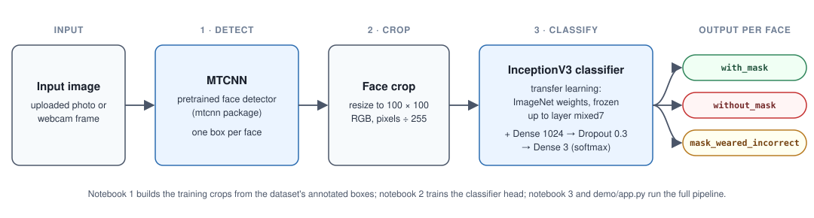

# FACEMASK_MTCNN: face-mask detection with MTCNN and a transfer-learned InceptionV3 classifier

[](https://creativecommons.org/licenses/by-nc-nd/4.0/)

## Overview

A webcam detector that finds faces with MTCNN and labels each one `with_mask`, `without_mask` or `mask_weared_incorrect` using an InceptionV3 network fine-tuned by transfer learning. Three notebooks cover data preparation, training and webcam detection, and a small Gradio app runs the same pipeline on an uploaded photo. It is a teaching project: the notebook runs at about 1.3 frames per second, so it is a live webcam detector, not a real-time one.

## Demo

There is no hosted demo. You can run one locally after training the model (see [Getting started](#getting-started)):

```bash
python demo/app.py --weights data/inceptionV3-model.h5
```

It opens a Gradio page where you upload an image or take a webcam snapshot and get labelled boxes back. The app does not save images. The example images come from the CC0 dataset described below.

## Problem statement

Decide, for every face in an image, whether the person is wearing a mask, wearing none, or wearing one incorrectly (for example under the nose). The "worn incorrectly" class is the interesting one: it is rare, and the hardest to get right.

## Approach



1. **Detect.** MTCNN (pretrained, from the `mtcnn` package) proposes a box for each face. It is not trained in this repository.
2. **Crop.** Each box is cut out, resized to 100 x 100 pixels and scaled to 0-1.
3. **Classify.** InceptionV3 with frozen ImageNet weights, cut at layer `mixed7`, followed by Flatten, Dense 1024, Dropout 0.3 and Dense 3 with softmax. Only the new head is trained (12.6 million of 21.6 million parameters are trainable), with Adam and categorical cross-entropy for 20 epochs.

Notebook 2 splits the data **by source photo**, not by face. Many photos contain several faces, and a face-level random split would put faces from the same photo in both the training and the test set.

## Data

| | |
|---|---|
| Source | Kaggle, [Face Mask Detection](https://www.kaggle.com/datasets/andrewmvd/face-mask-detection) by andrewmvd. The images and annotations come from the Make ML [Mask Dataset](https://makeml.app/datasets/mask). |
| License | CC0 1.0 (public domain dedication) |
| Size | 853 PNG photos with 853 PASCAL VOC XML files (about 400 MB, in `data/`), 4,072 annotated faces |
| Classes | `with_mask` 3,232 (79.4%) · `without_mask` 717 (17.6%) · `mask_weared_incorrect` 123 (3.0%) |
| Split (2026-10-13 run) | train 3,299 crops / 700 photos · validation 366 / 70 · test 407 / 78; seed 42; no photo in two splits |

**Privacy.** The images show real people's faces from a public dataset. CC0 describes the dataset's copyright status; it does not say whether the people shown consented. The images are used here only to train and test the classifier, and the demo's example images come from this dataset. If you appear in a photo and want it removed from this repository, contact the author through the links below.

## Results

| Metric | Value | Status | How measured | Date |
|---|---|---|---|---|
| Test accuracy | 94.85% (387 of 408 crops) | Reported (notebook output, unseeded split; ~91% of test crops share a source photo with training crops, so it overstates generalisation) | Original notebook 2 output: random face-level 10% split, no seed, so it cannot be recreated | Feb 2022 |
| Test accuracy | 96.31% (392 of 407 crops) | Verified (re-run 2026-10-13, photo-grouped split) | `model.evaluate` on 78 held-out photos, final epoch-20 model, seed 42 | 2026-10-13 |
| Per-class F1 | without_mask 0.929 · with_mask 0.979 · mask_weared_incorrect 0.700 (macro F1 0.869) | Verified (re-run 2026-10-13, photo-grouped split) | `sklearn` classification report on the same test set | 2026-10-13 |
| Majority-class baseline | 79.4% | Verified (re-run 2026-10-13, photo-grouped split) | Always predicting `with_mask` on the test set (323 of 407) | 2026-10-13 |
| Webcam speed | about 1.3 FPS | Reported (notebook 3's own note; the author's machine was not recorded) | Live loop in notebook 3 | Feb 2022 |

Full numbers (per-class precision and recall, the confusion matrix, split sizes and the seed) are in [`docs/runs/2026-10-13-grouped-split.md`](docs/runs/2026-10-13-grouped-split.md).

**Why the two accuracies differ, and why they cannot be compared directly.** The 2022 figure comes from a random split by face, so most test faces had a sibling from the same photo in training (and five duplicate photos sat on both sides). The 2026 figure comes from a split by photo, which is a fairer test on unseen scenes. You might expect it to be lower; it is not. Both are single runs on one split of a small test set. With only 12 `mask_weared_incorrect` test crops, one crop moves that class's recall by 8 points, and 1.5 points of overall accuracy is about 6 crops. The new run neither confirms nor refutes the 2022 number: it is a different, dated measurement on a different test set. The weakest result in both runs is recall on `mask_weared_incorrect` (7 of 12 here, 7 of 13 in 2022).

## Tech stack

Python 3.11, TensorFlow 2.21 / Keras 3.15, `mtcnn` 1.0.0, OpenCV 5.0, scikit-learn 1.9, NumPy, pandas, seaborn, Matplotlib, Jupyter and Gradio (demo only). Exact pins are in `requirements.txt` and `demo/requirements.txt`.

## Getting started

Prerequisites: Python 3.11, Git, a CPU (no GPU needed) and about 1.5 GB of free disk for the data and generated files, plus the Python environment. Installing TensorFlow takes about 5 minutes.

```bash
git clone https://github.com/Janeferdinant/FACEMASK_MTCNN.git
cd FACEMASK_MTCNN
python -m venv .venv
source .venv/bin/activate        # Windows: .venv\Scripts\activate
pip install -r requirements.txt
```

Run the notebooks in order, either in `jupyter notebook` or headless (`--inplace` overwrites the saved outputs in the notebook files):

```bash
jupyter nbconvert --to notebook --execute --inplace --ExecutePreprocessor.timeout=1200 1_data-preprocessing.ipynb
jupyter nbconvert --to notebook --execute --inplace --ExecutePreprocessor.timeout=1200 2_training-face-mask-model.ipynb
```

Expected on a CPU laptop (2026-10-13 run): notebook 1 takes about 30 seconds and prints `Face crops : 4072 | distinct source photos : 848`. Notebook 2 takes about 5.5 minutes, prints `Test loss: 0.5154  Test accuracy: 0.9631  (407 face crops)` with seed 42, and writes `data/inceptionV3-model.h5`. A different TensorFlow version or CPU may change the last digits.

Try the Gradio demo on the trained model:

```bash
pip install -r demo/requirements.txt
python demo/app.py --weights data/inceptionV3-model.h5
```

Open http://127.0.0.1:7860. To check the pipeline without a browser, run `python demo/app.py --weights data/inceptionV3-model.h5 --check data/images/maksssksksss3.png`, which prints the detections as JSON. The weights path can also be given through the `FACEMASK_WEIGHTS` environment variable.

Notebook 3 (`3_detecting-mask-w-mtcnn.ipynb`) opens a webcam window. It was not re-run in 2026 because it needs a camera. It loads `data/inceptionV3-model.h5` and `data/category2label.pkl`, which notebooks 1 and 2 create.

## Project structure

```
1_data-preprocessing.ipynb        VOC XML -> 100x100 face crops -> data/X.npy, Y.npy, groups.npy
2_training-face-mask-model.ipynb  seeded photo-grouped split, InceptionV3 training, evaluation
3_detecting-mask-w-mtcnn.ipynb    MTCNN + classifier on webcam frames (original 2022 notebook)
demo/app.py                       Gradio app: image in, labelled boxes out
docs/pipeline.svg                 pipeline diagram
docs/runs/                        dated run logs
data/images, data/annotations     the dataset (CC0)
requirements.txt                  pinned versions that install on Python 3.11
```

Generated files (`data/*.npy`, `*.pkl`, `*.h5`, `*.keras`) are git-ignored. Model weights are not stored in this repository.

## Real-world applications

The same detect, crop, classify pattern applies to any task that needs a per-face or per-object label: safety-equipment checks (helmets, goggles), occupancy counting, and teaching examples of two-stage vision pipelines. This repository is a learning project and has not been tested for any such use.

## Limitations

- **Small, single-source data.** 853 photos from one public dataset, with 123 `mask_weared_incorrect` faces in total. The classifier is untested on other cameras, lighting, face angles, skin tones or mask styles.
- **Rare class.** `mask_weared_incorrect` has only 12 test crops, so its scores are noisy.
- **One split, one seed.** The 2026 results are one measurement without a confidence interval. The best-checkpoint variant (97.3% on the same test set, in the run log) was chosen on the validation set; the headline uses the final epoch, as the original notebook did.
- **Overfitting.** Validation loss rises from 0.28 at epoch 1 to 0.80 at epoch 20.
- **Speed.** Notebook 3 calls the model once per face per frame, and MTCNN takes about 0.2 s per image on CPU, which is why it runs at about 1.3 FPS. The demo batches faces but this is still not a real-time system.
- **Detector misses.** MTCNN can miss small faces (it found 5 of 9 on one dataset photo in the local demo check), and a missed face gets no label.
- **"Person Number"** in notebook 3's log counts detections per frame, not distinct people.
- **Faces of real people.** See the privacy note under Data.

## Future scope

- Group-aware cross-validation with confidence intervals instead of a single split.
- Class weighting or more `mask_weared_incorrect` examples, and a test on a second dataset.
- Batch the per-frame classification in notebook 3 and share one `predict()` function between the notebook and the demo.
- A hosted, upload-only demo once the weights have a permanent home.

## Credits & citation

- **Code.** The notebooks were adapted from [bnati5/FaceMe](https://github.com/bnati5/FaceMe) (MIT, (c) 2020 Nathanael Alemayehu). About 55% of the normalised code lines in notebooks 2 and 3 match it, including the model head and the webcam loop. The full MIT notice is in [THIRD_PARTY_NOTICES.md](THIRD_PARTY_NOTICES.md). This repository's changes: 100x100 inputs, VOC parsing, date/time logging, the photo-grouped split and seed, Keras 3 updates, the Gradio demo and this documentation.
- **Dataset.** Kaggle "Face Mask Detection" by andrewmvd (CC0), from the Make ML [Mask Dataset](https://makeml.app/datasets/mask).
- **MTCNN.** Zhang, K., Zhang, Z., Li, Z. and Qiao, Y., "Joint Face Detection and Alignment Using Multitask Cascaded Convolutional Networks", IEEE Signal Processing Letters, 2016. Implementation: [ipazc/mtcnn](https://github.com/ipazc/mtcnn) (MIT).
- **InceptionV3.** Szegedy, C. et al., "Rethinking the Inception Architecture for Computer Vision", CVPR 2016. ImageNet weights from Keras.

## License

Original work © Jane Rose Ferdinant, licensed CC BY-NC-ND 4.0. Third-party components retain their own licenses; see THIRD_PARTY_NOTICES.md.

## Author

Jane Rose Ferdinant · [Portfolio](https://janeferdinant.vercel.app) · [LinkedIn](https://www.linkedin.com/in/janerosenf/)
